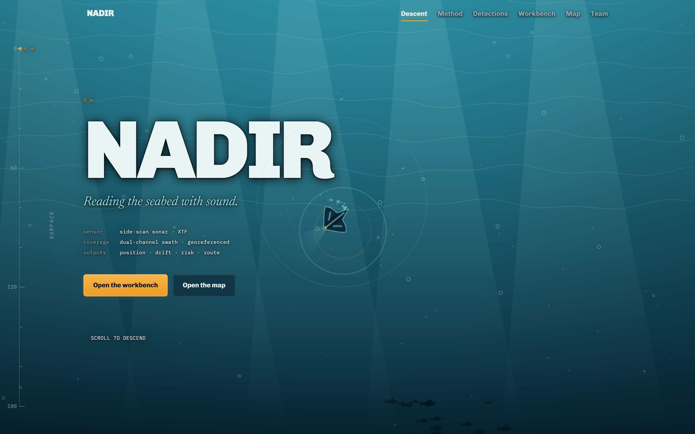
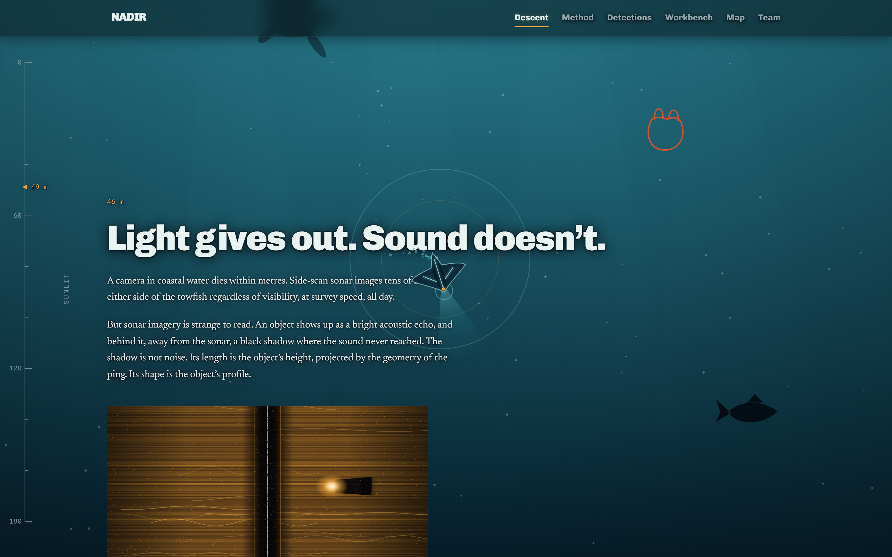
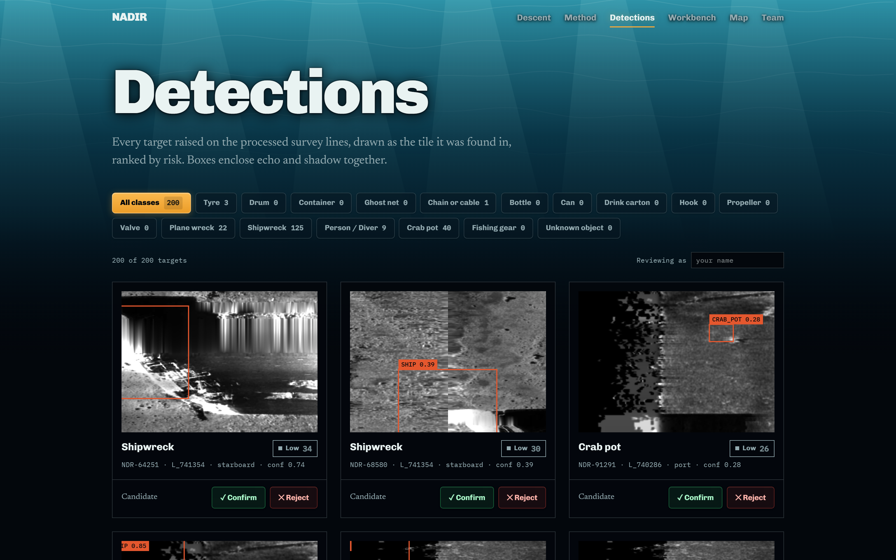
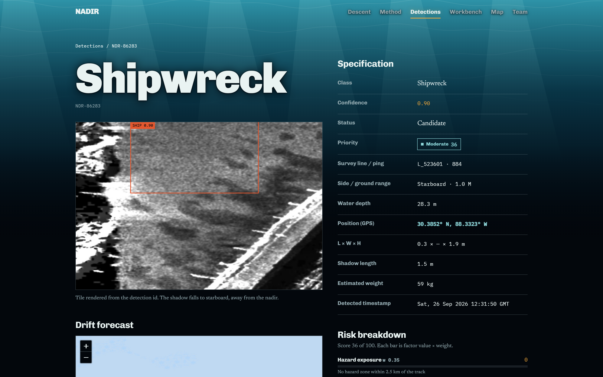
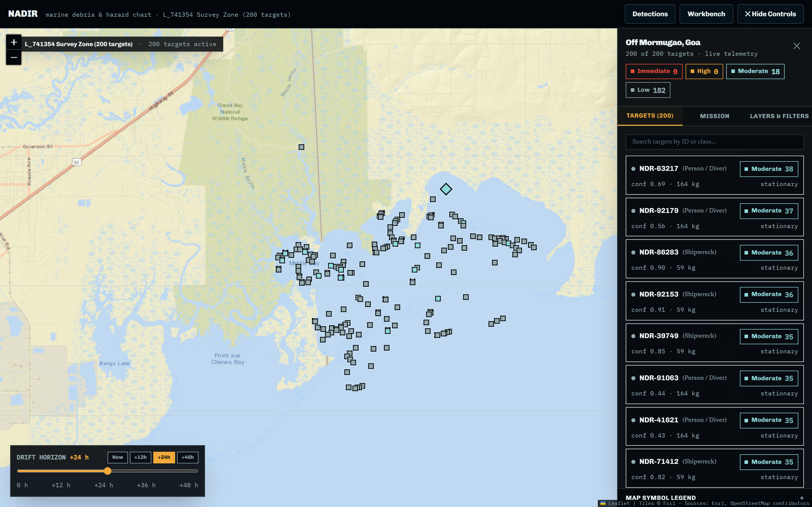
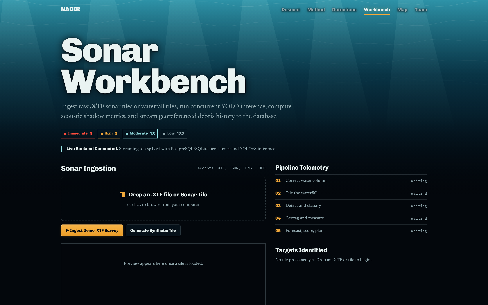
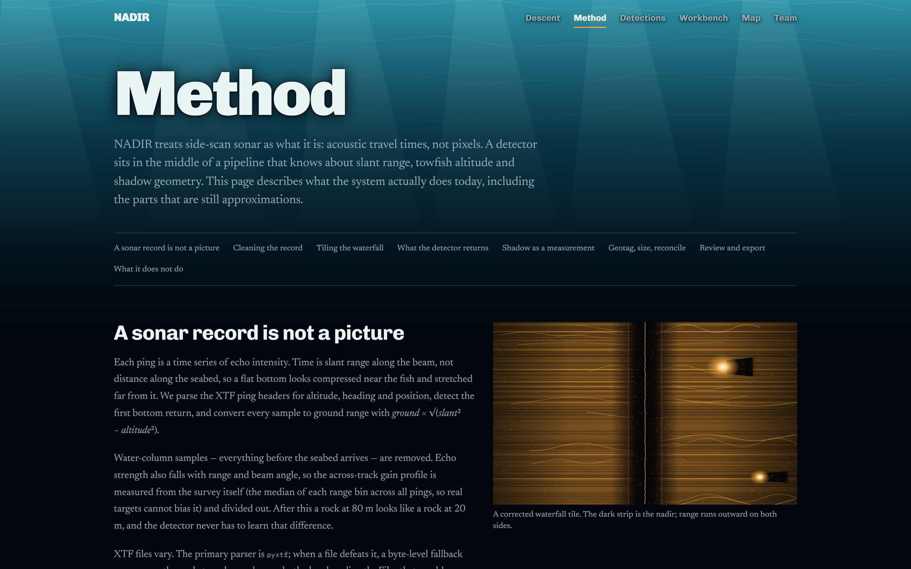

# NADIR

**Reading the seabed with sound.**

NADIR finds marine debris and seabed hazards in raw side-scan sonar, geotags every target,
estimates its size from the acoustic shadow it casts, scores the risk it poses, and plans the
clean-up route. You give it an `.XTF` survey file; it gives you a reviewed, georeferenced
catalogue you can export to a nautical chart.

Built for **Smart India Hackathon 2026** by team **BYTE ME**.

<p align="center">
  
</p>

---

## Table of contents

- [The problem](#the-problem)
- [What NADIR actually does](#what-nadir-actually-does)
- [Screenshots](#screenshots)
- [The pipeline](#the-pipeline)
- [The detector](#the-detector)
- [Tech stack](#tech-stack)
- [Repository layout](#repository-layout)
- [Quick start](#quick-start)
- [Configuration](#configuration)
- [API reference](#api-reference)
- [Testing](#testing)
- [Data provenance](#data-provenance)
- [Known limitations](#known-limitations)

---

## The problem

Ghost nets, tyres, drums and lost fishing gear sit on the seabed where nobody can see them.
Side-scan sonar is the instrument that can find them, but a raw sonar record is not a picture —
it is a stack of acoustic travel times. Before anything can be detected in it, the geometry has
to be undone: the water column removed, slant range converted to ground range, the beam pattern
flattened, speckle suppressed.

Most debris tooling skips this and treats sonar frames as ordinary images. NADIR does not. The
detector sits in the middle of an acoustic pipeline that knows about towfish altitude, nadir
position and shadow geometry — which is what makes a bounding box convertible into a latitude,
a longitude and a height in metres.



An object shows up as a bright acoustic echo, and behind it — away from the sonar — a black
shadow where the sound never reached. The shadow is not noise. Its length is the object's height
projected by the geometry of the ping, and its shape is the object's profile.

---

## What NADIR actually does

| Stage | Output |
|---|---|
| Ingest a raw `.XTF` survey line | pings, navigation fixes, towfish telemetry |
| Correct the acoustic geometry | a flat, evenly-lit waterfall in ground range |
| Tile and run detection | class + confidence + box, per 640×640 tile |
| Derive physical quantities | lat/lon, ground range, water depth, shadow length, estimated height |
| Score and forecast | risk tier 0–100, drift forecast to +48 h |
| Review and export | analyst confirm/reject, GeoJSON chart layer, CSV review sheet |

Everything after the detector is **derived**, not predicted. The model returns exactly three
things — a class, a confidence and a normalised rectangle. Position, size, height, mass and risk
all come from that box plus the geometry around it, which is why each of those assumptions is
stated rather than hidden.

---

## Screenshots

### Detections catalogue

Every target raised on the processed survey lines, drawn as the tile it was found in and ranked
by risk. Boxes enclose echo and shadow together. Analysts confirm or reject in place.



### Target detail

Full acoustic telemetry for one target: survey line and ping, side of the nadir, ground range,
water depth, GPS position, measured extents, shadow length, estimated mass, and a risk breakdown
where every factor is reported so a reviewer can argue with it.



### Map and mission chart

All geotagged targets on a live chart, coloured by risk tier, with a drift horizon slider
(now / +12 h / +24 h / +48 h) and mission planning against a home port.



### Sonar workbench

Drop an `.XTF` file or a single waterfall tile and watch the pipeline run: water-column
correction, tiling, detection, geotagging, forecast — each stage reporting as it completes.



### Method

A full written account of the processing chain, including the parts that are still
approximations.



---

## The pipeline

Running order, all under `backend/app/pipeline/`:

| # | Stage | Module |
|---|---|---|
| 1 | Parse XTF pings, navigation & telemetry | `acoustic/xtf_processor.py` |
| 2 | **Denoise pass A** — bad-ping repair, spike clipping | `acoustic/denoise.py` |
| 3 | Water-column removal (first bottom return) | `acoustic/water_column.py` |
| 4 | Slant-to-ground geometric correction | `acoustic/slant_range.py` |
| 5 | **Denoise pass B** — beam pattern, destripe, despeckle | `acoustic/denoise.py` |
| 6 | Port/starboard compositing & contrast stretch | `acoustic/gain_correction.py` |
| 7 | Overlapping 640×640 JPG tiles + geo metadata | `acoustic/tiling.py` |
| 8 | YOLO inference + geo/acoustic derivation | `yolo_detector.py` |

A few decisions in there are deliberate and worth knowing about:

**Slant range to ground range.** Time along the beam is not distance along the seabed, so every
sample is converted with `ground = √(slant² − altitude²)` using the altitude from the ping header.
After this a rock at 80 m looks like a rock at 20 m, and the detector never has to learn that
difference.

**Bad pings are repaired, never dropped.** Every waterfall row is indexed against a navigation
fix. Dropping a row would desync the two channels and shift every downstream detection's lat/lon,
so dead and saturated pings are found with a median-absolute-deviation test and rebuilt by
interpolating their neighbours.

**Denoising runs in two passes, either side of the geometry.** Pass A has to run on raw
backscatter because one saturated ping drags the first-bottom-return search off the true seabed.
Pass B runs per channel *after* geometry, so each transducer's gain profile is measured against
real ground range and the despeckle window never straddles the port/starboard seam.

**The despeckle chain is `lee+bilateral`, in that order.** This is not a preference. The deployed
weights were trained on tiles filtered exactly that way, so inference has to reproduce it or the
model sees different image statistics than it learned from.

**Shadow is a measurement.** Side-scan does not measure height directly, but for a towfish at
altitude `a`, an object at ground range `R` casting a shadow of length `L` has height:

```
h = (L × a) / (R + L)
```

**Tiles overlap by 128 px.** A target near a seam appears whole in at least one tile.

**The XTF parser has a fallback.** `pyxtf` is the primary reader; when a file defeats it, a
byte-level fallback re-syncs on the packet marker and unpacks the headers directly, so files that
would otherwise be unreadable still process.

---

## The detector

A single-stage **YOLOv8** model, trained for 50 epochs on speckle-filtered sonar tiles.

| Metric | Value |
|---|---|
| mAP@50 | **0.775** |
| mAP@50-95 | 0.559 |
| Precision | 0.844 |
| Recall | 0.788 |

**14 classes:** `bottle`, `can`, `chain`, `drink_carton`, `hook`, `propeller`, `tire`/`tyre`,
`valve`, `plane`, `ship`, `human`, `ghost_net`/`ghost-net`, `crab_pot`, `fishing_gear`.

Each class carries physical priors used downstream — bulk density for the mass estimate, mobility
and windage for the drift model, severity for the risk score. They live in `src/site/data.js`.

> **Model weights are not in this repository.** `new.pt` is ~137 MB, well over GitHub's 100 MB
> per-file limit, so it is distributed out of band. Drop `new.zip` into `backend/` and the
> detector unpacks it to `new.pt` automatically on first inference. Without it, set
> `USE_STUB_MODEL=true` to run against a deterministic stub detector.

---

## Tech stack

**Frontend** — React 18, Vite 8, Tailwind CSS 4, React Router 6, Leaflet / React-Leaflet.
No component library; the entire interface is hand-built, including the scroll-driven descent
canvas on the landing page.

**Backend** — FastAPI, SQLAlchemy 2.0 (async), PostgreSQL via `asyncpg` with an automatic SQLite
fallback, Pydantic v2 settings, Ultralytics YOLO, NumPy/SciPy for the acoustic chain.

---

## Repository layout

```
.
├── src/                          React frontend
│   ├── pages/                    Landing, Method, Detections, Detail, Upload, Map, Team
│   ├── components/               Map, sonar tile renderer, detection table, descent canvas
│   ├── lib/                      risk scoring, drift model, geo maths, routing
│   └── site/
│       ├── data.js               all editable content + class physical priors
│       ├── api.js                the only module that talks to the backend
│       └── mock.js               browser-side mock, same shapes as live
│
├── backend/
│   ├── app/
│   │   ├── api/v1/endpoints/     detect, xtf, detections, surveys, exports, stats
│   │   ├── pipeline/
│   │   │   ├── acoustic/         the XTF → tiles processing chain
│   │   │   ├── yolo_detector.py  real inference
│   │   │   └── stub_detector.py  deterministic fakes for offline dev
│   │   ├── models/               SQLAlchemy ORM: Survey, Detection, Review
│   │   ├── schemas/              Pydantic request/response contracts
│   │   └── services/             XTF orchestration, detection, export
│   ├── tests/                    pytest suite
│   └── storage/                  generated tiles, uploads, exports (gitignored)
│
└── docs/screenshots/             the images used in this README
```

---

## Quick start

### Prerequisites

- Node.js 18+
- Python 3.11+
- *(optional)* PostgreSQL — omit it and the backend falls back to local SQLite

### 1. Backend

```bash
cd backend
python -m venv venv
source venv/bin/activate          # Windows: venv\Scripts\activate
pip install -r requirements.txt

cp .env.example .env              # then edit if needed
uvicorn app.main:app --reload --port 8000
```

- API docs (Swagger): <http://localhost:8000/docs>
- ReDoc: <http://localhost:8000/redoc>
- Health: <http://localhost:8000/health>

On startup the backend creates its tables, mounts `storage/` for serving generated tiles, and
logs which database it connected to. If `DATABASE_URL` points at PostgreSQL and it is
unreachable, it logs a warning and continues on SQLite rather than failing to boot.

### 2. Frontend

```bash
npm install
npm run dev
```

Open <http://localhost:5173>. Vite proxies `/api` and `/storage` to the backend on port 8000, so
both run side by side with no CORS configuration.

### 3. Process a survey

Open the **Workbench**, drop an `.XTF` file, and the full chain runs end to end. Or go straight
at the API:

```bash
curl -X POST http://localhost:8000/api/v1/xtf/upload \
     -F "file=@your_survey.xtf" \
     -F "line_name=L01"
```

You get back the survey (ping count, navigation bounds, swath width), every tile it generated,
and every detection with its class, confidence, position and derived acoustic measurements.

### Available scripts

| Command | Does |
|---|---|
| `npm run dev` | Vite dev server on :5173 |
| `npm run dev:backend` | uvicorn with reload on :8000 |
| `npm run build` | production build to `dist/` |
| `npm run preview` | serve the production build |
| `npm run lint` | oxlint |

---

## Configuration

### Frontend — `src/site/data.js`

```js
export const API = {
  mode: 'live',          // 'live' | 'mock' — 'mock' runs the whole UI with no backend
  baseUrl: '/api/v1',
};
```

`SITE.area` sets the chart's survey area, home port and default zoom; `SITE.classes` holds the
per-class physical priors; `SITE.vessel` holds the clean-up vessel figures used by mission
planning. Values that still need calibrating against real figures are marked `TODO` in place.

> Note: `SITE.area` currently reads *Off Mormugao, Goa* while the bundled demo detections are
> from a US survey in Mississippi Sound (see [data provenance](#data-provenance)). The map
> centres on the real detections; the label is the one piece of placeholder copy you will notice.

### Backend — `backend/.env`

```bash
DATABASE_URL=sqlite+aiosqlite:///./nadir.db
CORS_ORIGINS=http://localhost:5173,http://localhost:3000

MODEL_PATH=new.pt           # auto-extracted from new.zip if absent
USE_STUB_MODEL=false        # true → deterministic fake detections, no weights needed

DENOISE_ENABLED=true
DESPECKLE_METHOD=lee+bilateral   # lee | median | bilateral | nlm | wavelet | none, chained with +
DESPECKLE_FILTER_SIZE=5
DENOISE_BEAM_PATTERN=true
DENOISE_DESTRIPE=true
DENOISE_REPAIR_BAD_PINGS=true
```

`lee` is dependency-free and edge-preserving, so targets and their acoustic shadows survive it.
`median` needs SciPy, `bilateral` needs `opencv-python`, `nlm`/`wavelet` need `scikit-image`. A
missing backend logs a warning and falls back to `lee` rather than failing the upload.

---

## API reference

Base path `/api/v1`.

| Method | Endpoint | Description |
|---|---|---|
| `POST` | `/detect` | Upload a single sonar tile (`multipart/form-data`) → bounding boxes |
| `POST` | `/xtf/upload` | Upload a full `.XTF` survey → slicing, inference, DB sync |
| `GET` | `/detections` | Query the catalogue with filters (`cls`, `status`, `line`, paging) |
| `GET` | `/detections/{id}` | One target: full details and acoustic telemetry |
| `PATCH` | `/detections/{id}/review` | Analyst review (`Confirmed by review` / `Candidate` / `Rejected`) |
| `GET` | `/surveys` | List registered survey line tracks |
| `POST` | `/surveys` | Register survey line metadata |
| `GET` | `/exports/geojson` | Nautical chart layer, GeoJSON `FeatureCollection` |
| `GET` | `/exports/csv` | Inspection review sheet, CSV |
| `GET` | `/stats` | Summary metrics: class breakdown, review progress |

A detection record carries: `id`, `cls`, `conf`, normalised `x/y/w/h`, `side`, `range_m`,
`depth_m`, `lat`, `lon`, `echo_len_m`, `shadow_len_m`, `height_est_m`, `line`, `ping`, `status`,
`image_url`, `survey_id`.

**A detection with no navigation fix stays unlocated.** No placeholder coordinate is ever
substituted — an invented position is indistinguishable from a real one once it reaches the map,
the risk score and the exports.

---

## Testing

```bash
cd backend
pytest tests/ -v
```

The suite covers the denoising stages, navigation and georeferencing, image URL construction, and
the API contracts.

```bash
npm run lint     # frontend
npm run build    # typecheck-free production build
```

---

## Data provenance

The bundled demo catalogue was produced by running this pipeline over **public USGS side-scan
sonar surveys** of Mississippi Sound, in the Gulf of Mexico (around 30.38° N, 88.39° W). The
detections, tiles, positions and depths you see in the screenshots are real pipeline output over
real acoustic data — not mock-ups.

Raw `.XTF` files (~222 MB) and the trained weights are not committed; they are distributed out of
band. `backend/batch_run_all.py` reprocesses a directory of surveys to rebuild the catalogue.

---

## Known limitations

This section exists because the project states its approximations rather than hiding them.

- **Estimated heights are indicative, not surveyed.** The shadow-height equation and the altitude
  are real, but the shadow length fed into it is currently scaled from the box height by a fixed
  factor rather than derived from the tile's true metres-per-pixel.
- **Across-track width is not measured and is reported as `—`.** Side-scan resolves one horizontal
  extent plus a shadow that encodes height; width is not observable from a single pass.
- **The drift model is a demo.** `src/lib/drift.js` is a simplified analytic Lagrangian advection
  with a seeded current field, and physics is currently toggled off
  (`ENABLE_DRIFT_PHYSICS = false`), so targets render at their surveyed positions. The production
  path is OpenDrift driven by INCOIS/CMEMS currents and Open-Meteo wind, returning the same shape.
- **Risk weights are uncalibrated.** They are a transparent weighted sum, and every factor is
  reported alongside the score so a reviewer can disagree with it — but they still need a domain
  mentor's sign-off.
- **`/hazards` is not implemented.** The frontend degrades to an empty hazard layer rather than
  reporting an outage.
- **Ghost nets remain the hard class.** Nets drape; their shadow is diffuse and their echo is
  weak. This is said on the review sheet rather than papered over.

---

## Team

**BYTE ME** — Smart India Hackathon 2026.
